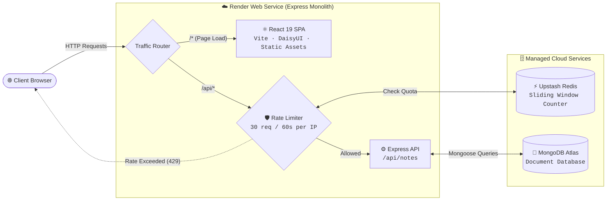

# ToDo MERN

A modern full-stack notes application built with React 19, TypeScript, Vite, Express 5, MongoDB Atlas, and Upstash Redis rate limiting.

---

## Architecture Overview



---

## Project Structure

```
ToDo-MERN/
├── frontend/             # React 19 + TypeScript + Vite + Tailwind CSS v4 + DaisyUI
├── backend/              # Express 5 + Mongoose 9 + Upstash Redis Rate Limiting
│   ├── src/              # Server source code (routes, middleware, config, models)
│   └── Todo/             # API request collection / testing files
├── pnpm-workspace.yaml   # Workspace configuration
└── package.json          # Root orchestration scripts
```

---

## Requirements

- **Node.js**: `>=24.0.0`
- **pnpm**: `>=12.11.2`
- **MongoDB**: MongoDB Atlas database (or local MongoDB)
- **Upstash Redis**: Serverless Redis database

---

## Local Development

1. **Install dependencies:**

   ```bash
   pnpm install
   ```

2. **Configure environment variables:**

   Create a `backend/.env` file:

   ```env
   MONGODB_URI=your_mongodb_connection_string
   UPSTASH_REDIS_REST_URL=your_upstash_rest_url
   UPSTASH_REDIS_REST_TOKEN=your_upstash_rest_token
   NODE_ENV=development
   PORT=5001
   ```

   > Node 24 natively loads this file via `--env-file-if-exists=.env` without external packages.

3. **Start development servers:**

   ```bash
   pnpm run dev
   ```

   - **Frontend**: [http://localhost:5173](http://localhost:5173)
   - **Backend API**: [http://localhost:5001](http://localhost:5001)

---

## Render Deployment

This project is configured to deploy as a single unified **Render Web Service**. Express hosts the API and serves the production-built Vite SPA.

### 1. Create Web Service in Render

1. Push your repository to GitHub / GitLab.
2. In Render, select **New +** → **Web Service** and choose your repository.
3. Configure the build and start commands:

   | Setting | Value |
   | --- | --- |
   | **Runtime** | `Node` |
   | **Build Command** | `pnpm run build` |
   | **Start Command** | `pnpm run start` |

4. Under **Environment Variables**, add:

   | Variable | Value | Notes |
   | --- | --- | --- |
   | `NODE_VERSION` | `24` | Required for Node 24 features |
   | `NODE_ENV` | `production` | Enables production asset serving |
   | `MONGODB_URI` | `mongodb+srv://...` | MongoDB connection string |
   | `UPSTASH_REDIS_REST_URL` | `https://...` | Upstash REST URL |
   | `UPSTASH_REDIS_REST_TOKEN` | `...` | Upstash REST Token |

### 2. Whitelist Render IP in MongoDB Atlas

Render instances use dynamic outbound IPs on standard/free plans:

1. In [MongoDB Atlas](https://cloud.mongodb.com/), go to **Security** → **Network Access**.
2. Click **Add IP Address**.
3. Select **Allow Access from Anywhere** (`0.0.0.0/0`) and click **Confirm**.

---

## API Endpoints

All API routes are protected by per-client-IP rate limiting (`30 requests / 60 seconds` via Upstash Redis):

| Method | Endpoint | Description |
| --- | --- | --- |
| `GET` | `/api/notes` | List all notes |
| `POST` | `/api/notes` | Create a new note |
| `GET` | `/api/notes/:id` | Fetch note details by ID |
| `PUT` | `/api/notes/:id` | Replace note content |
| `PATCH` | `/api/notes/:id` | Partially update a note |
| `DELETE` | `/api/notes/:id` | Delete a note |

---

## Available Scripts

Run from the root directory:

- `pnpm run dev` - Start both frontend and backend concurrently in development mode
- `pnpm run build` - Install dependencies across workspaces and compile frontend bundle to `frontend/dist`
- `pnpm run start` - Start backend production server (serves both API & SPA frontend)

---

## License

ISC
