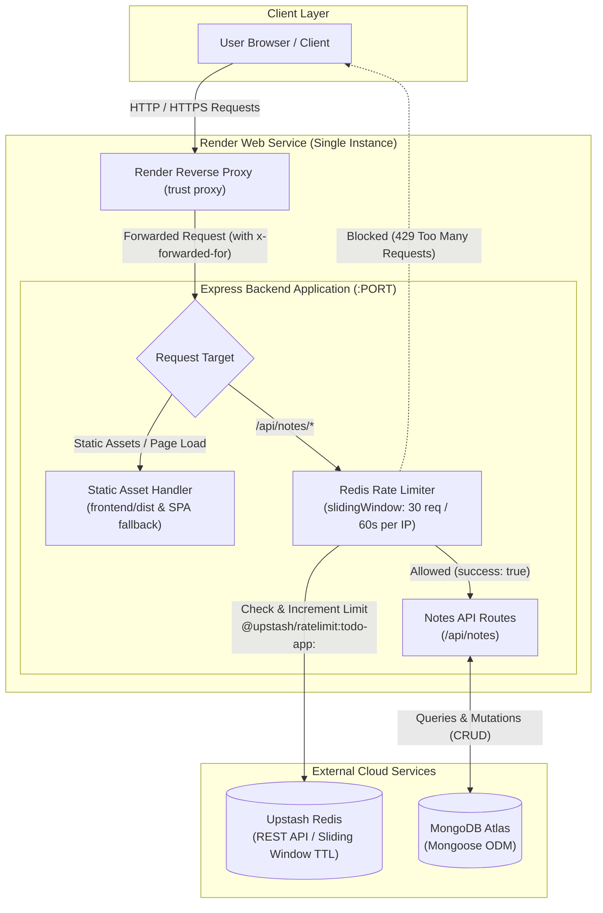

# ToDo MERN

A full-stack notes application built with React, TypeScript, Vite, Express, MongoDB Atlas, and Upstash Redis rate limiting.

## System Architecture



---

## Project Structure

- `frontend/` - React 19, TypeScript, Vite, Tailwind CSS v4, DaisyUI, TanStack Query
- `backend/` - Express 5, Mongoose 9, Upstash Redis Rate Limiting (Node 24 native env loading)
- `backend/Todo/` - API request collection files
- `pnpm-workspace.yaml` - Monorepo workspace configuration

## Requirements

- **Node.js**: `>=24.0.0`
- **pnpm**: `>=12.11.2`
- **MongoDB**: MongoDB Atlas database (or local MongoDB)
- **Upstash Redis**: Upstash Redis database (REST credentials)

---

## Local Development

1. **Install dependencies:**

   ```bash
   pnpm install
   ```

2. **Configure environment variables:**

   Create `backend/.env`:

   ```env
   MONGODB_URI=your_mongodb_connection_string
   UPSTASH_REDIS_REST_URL=your_upstash_rest_url
   UPSTASH_REDIS_REST_TOKEN=your_upstash_rest_token
   NODE_ENV=development
   PORT=5001
   ```

   > Node 24 natively loads this file via `--env-file-if-exists=.env`.

3. **Start local servers:**

   ```bash
   pnpm run dev
   ```

   - **Frontend**: `http://localhost:5173`
   - **Backend API**: `http://localhost:5001`

---

## Render Deployment

This project deploys as a single Render Web Service. Express hosts the API and serves the production-built Vite frontend assets.

### 1. Create the Service in Render

1. Push your repository to GitHub / GitLab.
2. In the Render Dashboard, click **New +** → **Web Service**.
3. Select your repository.
4. Configure service settings:

   | Setting | Value |
   | --- | --- |
   | **Runtime** | `Node` |
   | **Build Command** | `pnpm run build` |
   | **Start Command** | `pnpm run start` |

5. Add Environment Variables under **Environment**:

   | Variable | Value | Notes |
   | --- | --- | --- |
   | `NODE_VERSION` | `24` | Ensures Node 24 runtime |
   | `NODE_ENV` | `production` | Enables production static file serving |
   | `MONGODB_URI` | `mongodb+srv://...` | Connection string |
   | `UPSTASH_REDIS_REST_URL` | `https://...` | From Upstash Console |
   | `UPSTASH_REDIS_REST_TOKEN` | `...` | From Upstash Console |

### 2. Configure MongoDB Atlas IP Access

Render uses dynamic outbound IP addresses:

1. Open **MongoDB Atlas** → **Network Access**.
2. Click **Add IP Address**.
3. Choose **Allow Access from Anywhere** (`0.0.0.0/0`) and confirm.

---

## API Endpoints

All endpoints are protected by the Upstash Redis rate limiter (`30 requests / 60 seconds` per client IP):

- `GET    /api/notes` - List all notes
- `POST   /api/notes` - Create a note
- `GET    /api/notes/:id` - Fetch a single note
- `PUT    /api/notes/:id` - Replace a note
- `PATCH  /api/notes/:id` - Update a note
- `DELETE /api/notes/:id` - Delete a note

---

## Available Scripts

Run from the repository root:

- `pnpm run dev` - Run frontend and backend concurrently in development mode
- `pnpm run build` - Install dependencies across workspaces and compile frontend bundle
- `pnpm run start` - Start backend Express production server (serves API & SPA frontend)

---

## License

ISC
